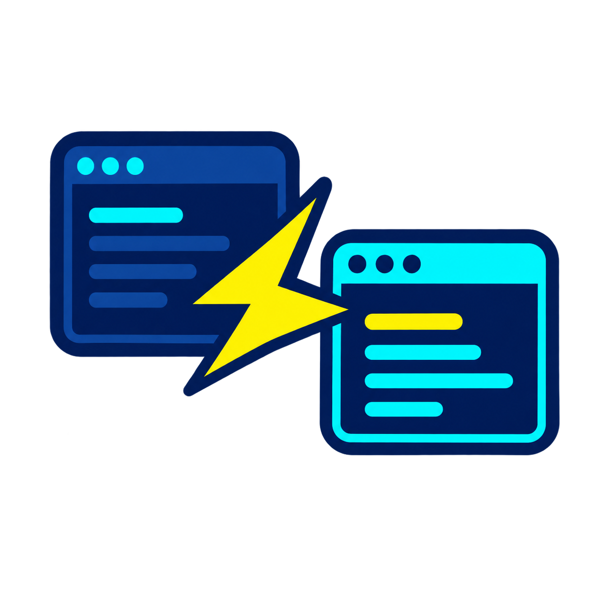

# pi-blitz-handoff

Steer your context. Hand off what matters.

<p align="center">
  
</p>

This extension is designed for one purpose: to capture a session’s continuation context more precisely than compaction and make it available to a fresh, natively linked Pi session through a local handoff file referenced by its first prompt. How work continues is determined by the user’s existing instructions, workflow, and templates.

> [!NOTE]
> **Unreleased feature — file-based handoff and optional Speed Mode**
>
> GO confirms only the safe work boundary; DONE is a separate submission after file finalization. Optional `speedMode: true` permits early template retrieval and drafting during genuine waiting, without resending the template after GO. It is disabled by default and promises no speed gain.
>
> The source model writes the dossier to `.pi/session/handoff_YYMMDDHHMMSS_SESSID.md`. The submission tool receives only the attempt ID; the fresh session starts with a short file reference. `debugging: false` (default) instructs the receiver to delete the file after complete ingestion; `true` instructs it to archive the file in `.pi/session/oldlog_donotread/`. Ingestion and cleanup are model instructions, not extension-enforced guarantees.

> [!NOTE]
> **Release Note — 1.3.1**
>
> All handoff dialogs now use themed terminal overlays. `/sh` opens the menu with **Start handoff** or **Cancel handoff** as its first action; `/sh start` starts directly, and typing `/sh ` shows the available subcommands.
>
> In released 1.3.1, the Call default explicitly says: do not write a handoff yet. Send GO when ready, then wait for the writer instruction containing the Handoff Template and submission ID. This is model guidance, not a technical write block. The V2 Handoff default is unchanged.

The “Blitz” in the project name is the author's surname, not a speed claim. Do not expect a handoff to be faster than compaction; its purpose is more precise context transfer, not speed.

Automatic handoff describes only how the transfer is triggered, not how the replacement session must work. Autonomous execution, interactive clarification, answering, research, and waiting are equal continuation modes. The extension transfers their existing instructions and authorization boundaries; it does not choose a workflow or grant new permission.

## Why V2 is the default

V2 has worked better in practice than the previous templates. It focuses the dossier on what the replacement session needs to continue, rather than accumulating session history and every past skill read. The template instructs the writer to:

- record the actual continuation mode, `userfacing` or `autonom`;
- preserve commissioned work, continuing grants and conditions, dirty state, blockers and evidence limits;
- list active skills by name, purpose and scope rather than accumulate every past read;
- keep the continuation core inline and reference known detail sources only for concrete retrieval needs; and
- apply deferred prompts first, then resume the dialogue or perform authorized autonomous work without a previous-session recap.

The transfer protocol is deterministic; the dossier and continuation are model-generated. V2 is an improved default, not a guarantee of lossless transfer. Results still depend on the model and available source context.

## Successful autonomous handoff

These two screenshots document an earlier continuous autonomous run, before V2 became the default. The fresh linked session receives the handoff with `Continue authorized autonomous work` and begins the recorded next action:

<p align="center">
  
</p>

The same replacement session then validates the working state and dispatches the next authorized reviewer without another user prompt:

<p align="center">
  
</p>

## Requirements

- Node.js 22.19.0 or later
- `@earendil-works/pi-coding-agent` 0.84.2 or later
- Pi's interactive chat surface
- A persisted source session
- Pi's native `write` tool, and a writable `.pi/session/` directory under the current Pi working directory

`--no-session` and other in-memory sessions cannot start a handoff because there is no source transcript path or native parent lineage.

## Installation

Install from npm:

```text
pi install npm:pi-blitz-handoff
```

Try it for one run without installing it globally:

```text
pi -e npm:pi-blitz-handoff
```

Or install directly from GitHub:

```text
pi install git:github.com/MircoBlitz/pi-blitz-handoff
```

Pi reads the extension entry point from `package.json`. Review third-party extensions before installing them: Pi extensions run with the permissions of the Pi process.

## Public interface

### Commands

| Command | Action |
|---|---|
| `/sh` | Open the handoff menu. |
| `/sh start` | Request a handoff directly. |
| `/sh help` | Show commands and usage. |
| `/sh cancel` | Cancel the active handoff before native cutover starts. |
| `/sh recover` | Inspect, execute or discard leftover deferred prompts. |
| `/sh settings` | Change global settings. Each confirmed edit applies immediately. |
| `/sh project-template` | Set or remove per-role template selections for the current directory. |

Only `/sh` is registered publicly. The former hyphenated commands and `/sh config` are no longer accepted.

There is no public retry command, cleanup command, or public transition command.

### Overlay dialogs

In Pi's terminal UI, `/sh` opens a themed overlay above the conversation. Its first action is **Start handoff**, or **Cancel handoff** while a handoff is active. The remaining actions open Recovery, Settings, Project templates and Help. Opening the menu does not start a handoff; Escape closes it without action.

All interactive handoff dialogs use the same overlay presentation, including setting inputs, directory confirmations, recovery-file inspection and **Ready / Wait / Cancel**. Clear headings, short descriptions and keyboard hints keep the controls discoverable. Recovery inspection is scrollable so the complete stored prompts remain accessible.

Type `/sh ` to see all subcommands with short descriptions; keep typing to narrow the list. Direct commands remain available when you already know what you need.

Overlays are terminal-only. RPC clients retain Pi's native selection, input and confirmation dialogs; they do not receive a simulated overlay. Dialog answers do not enter model context. The transfer protocol, template defaults and immediate settings persistence are unchanged.

### Model-callable tool

The `blitz_handoff` tool has two actions:

- `status` — report context usage, warning and automatic thresholds, the one-time readiness reminder delay, and current handoff status.
- `start` — request a handoff only when the user explicitly requested one.

Discussion, questions, criticism, testing, or a mention of handoffs are not start requests.

## How a handoff works

1. **Request a transfer.** Choose **Start handoff** from `/sh`, use `/sh start`, explicitly ask the model to start one, or enable automatic initiation. Explicit starts ignore context thresholds.
2. **Reach a safe boundary.** The Call Template tells the model to finish required work already in flight, not future tasks. By default this is readiness only. With Speed Mode enabled, optional early retrieval and drafting can use genuine waiting time without delaying required work. GO means only that the boundary is safe, not that the file is complete; it never switches sessions. After GO, wait for the writer/finalization instruction. This is model guidance, not a filesystem write block. Manual and model-requested readiness waits until Pi is idle with no pending messages. The model signals readiness through a tool with the current correlation key.
3. **Defer incoming prompts.** After GO, ordinary interactive and RPC prompts are captured unchanged and in order. They are kept in memory and atomically persisted to one recovery Markdown file; slash commands retain Pi’s native behavior.
4. **Write the dossier to a file.** At the next idle boundary with no pending messages, the source receives the attempt ID and absolute handoff-file path. Without preparation it also receives the current Handoff Template; with preparation it receives only a short finalization instruction and uses the previously retrieved template. Pi's native `read`, `write` and `edit` tools are enabled alongside `submit_session_handoff`. The source writes the complete Markdown to the file, using incremental edits if needed, then submits **DONE** separately through `submit_session_handoff({ id })`. Before DONE it must update relevant facts, results, permissions and the exact next action; the model owns that semantic review. Writer control is turn-local, not a transferred task restriction. Unprepared retries resolve the template afresh and replace partial file content; prepared retries retain the template snapshot and draft path without resending the template, but require a fresh DONE ID. Count and delay are configurable; the original tools are restored on success, cancellation, exhaustion or terminal failure.
5. **Start the replacement with a file reference.** Only after DONE and the existing settled boundary, the extension checks that the file is a nonempty regular file, without reading its dossier, and appends any deferred prompts in their original order. It sends a short first user turn containing the absolute path, startup instructions and the configured cleanup instruction. Native `parentSession` linkage normally preserves lineage. At the configured chain limit, the next session starts as an independent master with the same file reference instead.
6. **Ingest and clean up.** The receiver follows normal startup instructions and required basic skills, reads the entire file (continuing past truncated reads), then deletes it or archives it according to `debugging`. It leaves the file unchanged if reading fails or is incomplete. Separately, after successful native replacement and prompt delivery, the extension deletes the deferred-prompt recovery file. Cleanup failures must be reported; successful transport does not prove model ingestion or cleanup.

### Readiness and user deferral

`session_handoff_go` accepts direct GO. For a manual or model-requested handoff, `session_handoff_go_with_user_deferral` can open **Ready / Wait / Cancel** when a concrete active collaboration may still need the current session:

- **Ready** accepts GO.
- **Wait** keeps ordinary input available, suspends the reminder and shows `Awaiting User GO · Tell your LLM to start when ready`. A later explicit user readiness message lets the model call direct GO with the same key.
- **Cancel** ends the request.

The extension does not parse free-form replies. If neither permitted readiness tool is called, one reminder after `readinessRetrySeconds` reapplies the same Call Template and source-specific tool protocol. There is no periodic polling and no reminder after **Wait**.

### Optional Speed Mode

`speedMode` is off by default and can be toggled in `/sh settings` without reload. When enabled, all initiation sources receive additional readiness instructions and the optional `session_handoff_get_template({ key })` tool. Before GO it returns the selected template, absolute reserved file path and submission ID. Repeated retrieval shares one preparation. It does not accept GO or DONE, and disabled, stale or post-GO calls fail.

Use early drafting only during real waiting and with existing source tools. It must not delay required work or run concurrently with GO. Skipping retrieval is valid: the normal writer receives the template after GO. There is no artificial waiting phase. GO starts prompt deferral; DONE confirms the finalized file, and only DONE plus the settled boundary permits replacement. The extra calls/turns are an accepted trade-off, not a guaranteed acceleration.

### Automatic initiation

Automatic handoff is off by default. When enabled, the first completed turn at or above the configured threshold inserts readiness before the next model turn without interrupting tool work from the completed turn. Automatic readiness permits only direct GO; user deferral is unavailable so a choice dialog cannot stop autonomous work. Automatic initiation does not choose the replacement’s working mode or grant permission.

If the first automatic attempt fails or is cancelled, one final attempt becomes eligible at the critical-warning threshold. A second unsuccessful attempt is not repeated. Native session metadata preserves this budget across `/reload`. Successful manual, threshold or overflow compaction resets it; failed or aborted compaction does not.

The dossier’s first line is a model-written, task-specific Markdown title, inside the file rather than the replacement's initial prompt. The submission tool validates only attempt correlation. Before cutover, the extension checks file metadata, not Markdown structure, title meaning, NUL absence or semantic completeness.

At most one handoff is active. A second start is rejected without replacing the active state. Once native cutover has been invoked, cancellation is no longer available.

## Status and cancellation

The activity line is rendered as a Pi widget directly above the input editor. It does not depend on the configured footer or powerline. The persistent status uses these factual states:

- `Waiting for Session Handoff` in yellow;
- `User Input Required` in red while the extension-owned choice is open;
- `Writing Session Handoff`;
- `Session Handoff Finished`.

Failure and cancellation override those states. Finished status remains in the replacement session until its next agent run starts, ordinary user input arrives, or another handoff begins. Its second line reports the wait from initiation to accepted `GO` and the handoff time from `GO` to successful completion. After `GO`, the activity line shows `Inputs deferred (0)` and increments the count for every captured prompt.

Before GO is accepted, canonical `/sh cancel` clears pending readiness, the user-wait state and any cached optional preparation. After GO is accepted but before native replacement begins, it stops extension-owned writer work, restores the prior tools, and leaves a deferred-prompt recovery file for explicit recovery. Every successful cancellation sends a follow-up instruction that releases the model from the earlier readiness or writer request and resumes normal work. Deferred prompts are not replayed automatically to the source session.

From `GO` until completion or cancellation, user-initiated session replacement, fork, and compaction are blocked. The extension's own correlated native replacement is allowed.

A potential race between a still-pending asynchronous start and cancellation or shutdown has not been reproduced in normal operation. If you can reproduce it, please open an issue or PR with the smallest reliable reproduction; the extension does not add speculative lifecycle-token machinery.

## Recovery

`/sh recover` lists remaining top-level recovery Markdown files with their dates. For one selected file at a time, the dialog can:

- inspect the complete contents without changing the file;
- execute all stored prompts in the current session as one combined user turn that preserves their order and boundaries;
- discard exactly that file;
- return to the list or cancel.

Recovery is always explicit. It never automatically executes leftover prompts. Execution deletes the file only after message dispatch returns without an immediate error; unreadable files and immediately rejected dispatches are reported and retained.

## Settings

Run `/sh settings` in an interactive UI. Each confirmed setting change validates the complete resulting configuration, persists atomically, and takes effect immediately without `/reload`. Invalid input, rejected directory creation, or persistence failure retains the previous value and shows a concrete correction message. A missing configured directory is created only after confirmation of its exact path.

There is no overall draft, **Save**, or **Cancel** action. Escape discards an unconfirmed setting input; Escape from the setting list closes the dialog without undoing changes already persisted. Configuration cannot overlap an active handoff or recovery dialog, and a handoff cannot start while configuration is open.

Call and handoff template settings list the available, readable, nonempty templates for their role: `call_*.cmpl` for Call Templates and `handoff_*.cmpl` for dossier templates. **Enter another filename** remains available for manual `.cmpl` filename entry.

Persisted configuration updates the currently loaded extension directly.

| Setting | Default | Constraint |
|---|---:|---|
| `contextWarningPercent` | `60` | Finite number, at least 1 and below the critical threshold |
| `criticalWarningPercent` | `90` | Finite number, above the warning threshold and at most 100 |
| `automaticSessionHandoff` | `false` | Boolean |
| `speedMode` | `false` | Boolean; optional pre-GO template retrieval and drafting, separate GO/DONE unchanged |
| `debugging` | `false` | Boolean; `false` instructs deletion after complete ingestion, `true` instructs archival in `.pi/session/oldlog_donotread/` |
| `automaticSessionHandoffPercent` | `70` | Finite number from 0 through 100; 0 disables automatic initiation; first automatic-attempt threshold |
| `readinessRetrySeconds` | `60` | Integer from 1 through 300; delay before the single silent re-evaluation turn |
| `maxSessionChainLength` | `25` | Positive integer; includes the master; the next handoff at the limit starts an independent master |
| `writerAttempts` | `3` | Positive integer; total attempts including the first |
| `writerRetryDelaySeconds` | `30` | Integer from 1 through 300 |
| `recoveryDirectory` | managed recovery directory | Absolute directory path |
| `templateDirectory` | `null` | `null` or an absolute addendum-directory path |
| `callTemplate` | `call_default.cmpl` | `.cmpl` filename for readiness semantics, not a path |
| `handoffTemplate` | `handoff_default.cmpl` | `.cmpl` filename for the dossier writer, not a path |

The warning threshold produces one advisory warning. Critical warnings may repeat on settled turns. After an unsuccessful first automatic handoff, `criticalWarningPercent` is also the threshold for one final automatic attempt. Neither warning threshold nor the automatic threshold gates explicit starts.

### Subagents

`pi-subagents` normally starts foreground child agents with `--no-session`. The extension therefore rejects a handoff in those children because there is no persisted source session. Persisted children (for example, runs configured with a `sessionFile` or `sessionDir`) can load this extension and run their own independent handoff; that replacement affects only the child session and does not replace or transfer the parent session.

Automatic session handoff is disabled by default. When using persisted subagents, leave it disabled unless child-session handoff is deliberate, or configure those child agents not to load this extension. This avoids an unplanned child replacement that the parent orchestration does not automatically follow.

## Managed paths and templates

The extension manages:

```text
<getAgentDir()>/pi-blitz-handoff/
├── config.json
├── project-templates.json
├── recovery/
└── templates/
    ├── backups/
    ├── call_default.cmpl
    └── handoff_default.cmpl
```

Missing managed directories are created during load. The package installs its two default templates into the managed template directory. If same-name managed content differs, the old file is moved into the managed `templates/backups/` subdirectory with a timestamped filename before the package template is installed. Catalogue scans are nonrecursive, so backups do not appear in template selection. Other managed templates are retained. Deliberately configured directory symlinks are supported.

### Project-local handoff files

Optional early preparation or the normal writer reserves an owner-only file under the current Pi working directory:

```text
.pi/session/handoff_YYMMDDHHMMSS_SESSID.md
```

The timestamp uses local time, including minutes and seconds; `SESSID` is the native source-session ID. An existing same-name file is never overwritten by file reservation: a collision fails visibly. Retries within one writer reuse its reserved path. Unprepared attempts replace partial content; prepared attempts retain and update the draft.

`debugging` is a single boolean setting in `/sh settings` or `config.json`. After complete successful ingestion, `false` (default) tells the receiver to delete the exact file; `true` tells it to create `.pi/session/oldlog_donotread/` if needed and move the file there under the same filename. The receiver is told not to scan or read that archive without an explicit user request. The directory name is a reminder, not an access-control boundary. The extension does not read the dossier or perform receiver cleanup, and does not claim to verify ingestion. Cancelled, interrupted or failed handoffs can leave empty or partial files at the supplied path for manual inspection.

These files contain plaintext conversation context and should remain outside version control and publication. Exclude `.pi/session/` using your project's local Git exclude or ignore policy; the extension does not change that policy automatically. Archiving increases local retention. The new transport avoids placing the entire dossier in the submission tool or initial prompt, but file writing and reading still depend on the model, native tools and their output limits.

### Shipped defaults

| Template | Purpose |
|---|---|
| `call_default.cmpl` | Finish only required work already in flight, then transfer at a genuinely safe boundary. Prefer direct GO unless a concrete active user interaction still matters. |
| `handoff_default.cmpl` | The V2 dossier: explicit mode, commissioned work, permissions, current state, binding instructions, evidence limits and targeted retrieval. |

There are no packaged Fast, Balanced or development variants. Custom managed and addendum templates remain available.

### Upgrading to the V2 default

The package synchronizes the managed `handoff_default.cmpl` to V2, backing up different same-name content first. It does not delete other user-owned templates or change existing selections.

If you previously selected another Handoff Template, choose `handoff_default.cmpl` in `/sh settings` to use V2 globally. A project assignment can override that choice: select `<Default>` for the Handoff role in `/sh project-template` to use the default explicitly, or `<Autodiscover>` to inherit the nearest ancestor or global selection. A configured addendum directory can still shadow the managed default with a same-name file.

**Clean up unchanged legacy templates manually.** If you have not customized them, delete obsolete `default.cmpl`, `call_fast.cmpl`, `handoff_fast.cmpl`, `call_balanced.cmpl`, `handoff_balanced.cmpl`, `call_next.cmpl` and `handoff_next.cmpl` from your local managed template directory. An unchanged `handoff_v2.cmpl` can also be deleted: V2 is now shipped as `handoff_default.cmpl`. First switch any global or project selections that still reference these files to the current defaults. Keep customized templates and both current defaults (`call_default.cmpl` and `handoff_default.cmpl`). This is a manual cleanup recommendation, not automatic deletion by the extension; retained legacy `.cmpl` files can still appear in template selection.

Existing exact configurations lacking `debugging` or `speedMode` load with `false` for those fields in memory. Existing exact configurations lacking `maxSessionChainLength` load with `25` in memory; configurations predating `callTemplate` also gain `call_default.cmpl`. They are not rewritten automatically. The limit is configurable through `/sh settings` and applies immediately. Chain length comes from Pi's persisted parent-session headers, so `/resume` and `/reload` do not reset it. A new independent master starts at one. If a required ancestor cannot be read, cutover fails visibly rather than guessing a length.

### Project template assignments

Run `/sh project-template` to configure the current Pi working directory. The extension shows separate Call and Handoff selection boxes. `<Autodiscover>` leaves that role without a local override, `<Default>` selects its existing role-default filename directly, and the remaining choices are readable, nonempty role-specific templates. The default filename is not duplicated in the catalogue choices.

Each Enter persists that role immediately. If no exact assignment exists, the other role begins as `<Autodiscover>`. Escape discards only the currently unconfirmed choice, so a role confirmed earlier in the dialog remains saved. There is no separate Save action. Selecting `<Autodiscover>` for both roles removes the exact assignment: an existing assignment is reported as removed; when none exists, no file is written and the dialog reports that fact.

At each handoff, the extension reads `project-templates.json` and resolves Call and Handoff independently while walking upward from the current Pi working directory. Each role uses the nearest concrete selection; an unresolved role uses its global setting. `<Default>` bypasses further project and global selection for that role while using the unchanged template resolver. Assignments below the current directory are never considered.

If the project settings file is unreadable, invalid JSON, or fails validation, the start continues only when both role defaults genuinely resolve. One concise warning states the category, that role defaults are active for this handoff, and that the user may ask Pi to inspect the file. The extension does not repair or rewrite the file automatically.

You can customize the Call and dossier templates to make handoffs shorter and faster or more precise for your particular purpose. The extension still owns and appends the deterministic correlation, tool, and interaction rules.

Template discovery is nonrecursive. An optional addendum directory shadows a managed template with the same filename. Call and dossier templates use separate configuration fields but the same simple resolver. Each resolution attempts:

1. the selected addendum template, when configured and present, otherwise the selected managed template;
2. the role-specific addendum default (`call_default.cmpl` or `handoff_default.cmpl`), when configured;
3. the corresponding managed role-specific default.

A candidate must be a readable, nonempty `.cmpl` file. Both configured roles are checked at startup and whenever `/sh settings` opens. A failed non-default selection falls back to its role default with a visible warning that names the failure and actual fallback; selecting the role default does not itself warn. If the role default cannot resolve, startup or configuration opening fails visibly. There is no placeholder engine or embedded template fallback. Deterministic code always appends the current key, exact tool protocol, and interaction rules to the editable Call Template, so a custom template cannot own or remove those invariants.

## Data and security

Handoff dossiers may contain sensitive project and conversation context. Handoff files (and debugging archives) are plaintext under `.pi/session/`; deferred-prompt recovery files are plaintext in the configured recovery directory and contain prompt text unchanged, plus extension-owned boundaries. `project-templates.json` stores absolute directory paths and template filenames. New managed directories and files use restrictive creation modes, but the extension is not a sandbox and does not provide secret detection, encryption, inode tracking, or a general filesystem-adversary policy.

See [SECURITY.md](SECURITY.md) for the security and data-handling model.

## Package development

Clone the repository and install its development dependencies:

```text
npm install
```

The deterministic test suite covers unit, integration, and package testing; it is not end-to-end Real-Pi testing.

```text
npm test
npm run typecheck
npx tsc --noEmit --noUnusedLocals --noUnusedParameters
git diff --check
npm pack --dry-run
```

The unreleased file-based/Speed Mode candidate has deterministic local tests, not a real-model/session end-to-end validation. Earlier Real-Pi evidence below does not validate the new transport or receiver cleanup.

The candidate is tested for public registration, project-template selection and inheritance, composed success, rejection/failure, cancellation/recovery, package metadata, and packed-file boundaries. Version 1.1.0 was also validated interactively with current Pi across manual, automatic, model-initiated, user-deferral, cancellation, resume, tree, and fork behavior.

On 2026-09-30, a Real-Pi handoff at the end of an existing 10-session chain, using an isolated test limit of 10, created an independent master with no native parent reference. The replacement continued with its re-entry summary and waited as instructed. The default 25-session boundary is covered by deterministic tests, not that Real-Pi run. See [session-chain validation](docs/session-chain-validation.md) for evidence and scope.
